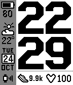
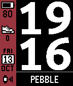
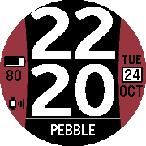

T# NineTime

A highly customizable digital and analog watchface for Pebble, created by **Andor Czafik**.
This repository starts from **NineTime 1.92**, the original release for the classic Pebble
watch family, together with its PHP configurator. **Version 1.92 is the original baseline
for future development in this repository.**

[Original project page](https://czandor.hu/pebble/ninetime/) · [Rebble Appstore](https://apps.rebble.io/en_US/application/59de171d461a8da6ca0025f9)

  
  &nbsp;
  
  &nbsp;
  

## Original supported watches — version 1.92

| SDK platform | Watches |
| --- | --- |
| `aplite` | Pebble (original / Classic), Pebble Steel |
| `basalt` | Pebble Time, Pebble Time Steel |
| `chalk` | Pebble Time Round |
| `diorite` | Pebble 2, including Pebble 2 SE |

These are the target watches of the original 1.92 project. Health features depend on
the watch hardware; Pebble 2 SE does not have a heart-rate sensor.
Platform names follow the [official Pebble hardware reference](https://developer.repebble.com/guides/tools-and-resources/hardware-information/).

Ports to newer watches, including **Pebble Time 2**, are separate work beyond this baseline.

## Features

- Six digital font types and three analog face types — the original nine behind the NineTime name.
- Configurable colors, digit styles, sidebars, information rows, and localized day/month names.
- Weather, forecasts, steps, heart rate, battery, and upcoming holidays on supported watches.
- Optional seconds and information panels triggered by tap/shake.
- A web configurator with previews and saved configurations.
- Custom information scripts for periodically displaying your own text or data.

These describe the historical watchface. The legacy weather providers and backend services
need separate validation before a new deployment.

## Repository layout

| Path | Contents |
| --- | --- |
| `watchface/src/c/` | Watchface C source |
| `watchface/src/pkjs/` | Phone-side JavaScript |
| `watchface/resources/images/` | Original digit and icon bitmaps used by the build |
| `web/public/` | PHP endpoints, configurator, scripts, and web assets |
| `web/config/` | Configuration example; private local settings are ignored |
| `web/bootstrap.php` | Shared configuration and database connection |
| `database/schema.sql` | Database structure without production data |
| `tools/` | Configuration, validation, secret detection, and source export |
| `docs/` | Setup notes and original preview images |

## Configure and build

Node.js and PHP are needed for the local checks. No npm dependencies are required.
Building the watchface also requires the Pebble SDK.

~~~powershell
Copy-Item web/config/config.example.php web/config/config.local.php
Copy-Item watchface/config.example.json watchface/config.local.json
~~~

Set the public server URL in both configuration files. Keep database credentials and shared
weather API keys only in the private PHP configuration or server environment variables.
The watchface configuration contains **only the public URL**.

~~~powershell
node tools/configure-watchface.cjs
node tools/verify.cjs
node tools/smoke-test.cjs
Set-Location watchface
pebble build
~~~

The generated `watchface/src/pkjs/site-config.json` is ignored by Git.
The watchface still targets the original `aplite`, `basalt`, `chalk`, and `diorite` platforms.
**Pebble Time 2 / Emery support is not implemented in this snapshot.**

## Run the web configurator

Import `database/schema.sql` into an empty MySQL/MariaDB database and fill in the private
server configuration. PHP needs `mysqli` and `curl`; dynamic image rendering also needs `gd`.

~~~powershell
php -S 127.0.0.1:8000 -t web/public
~~~

Open `http://127.0.0.1:8000/pebble/ninetime/`. The document root must be **`web/public`**,
so the private configuration remains outside the served directory.
The configurator can render without a database; saving/loading and the backend services require one.

## Secrets and source preservation

Original passwords, shared weather keys, OAuth credentials, database rows, compiled installers,
design files, fonts, and historical backups are excluded from the repository.
Only empty configuration examples and a schema without production data are published.

~~~powershell
git config core.hooksPath tools/git-hooks
node tools/check-secrets.cjs
pwsh -File tools/export-source.ps1
~~~

The pre-commit hook checks the actual staged contents. Source exports include only Git-selected
files and are checked before packaging. On the original workstation, historical material and
the untouched source backup are kept in the ignored `local-only/` folder.

See [security notes](SECURITY.md) for the inherited backend limitations and
[setup details](docs/SETUP.md) / [Hungarian development guide](docs/DEVELOPMENT.hu.md).

## Credits

The original configurator retains its author and font credits, including Ubuntu, Mr. Robot,
Atari, LECO 1976, and Bosa Nova. Font files and PSD working files are not bundled here;
the watchface uses the existing raster assets. Publishing this source does not change
the original third-party assets' usage terms.
